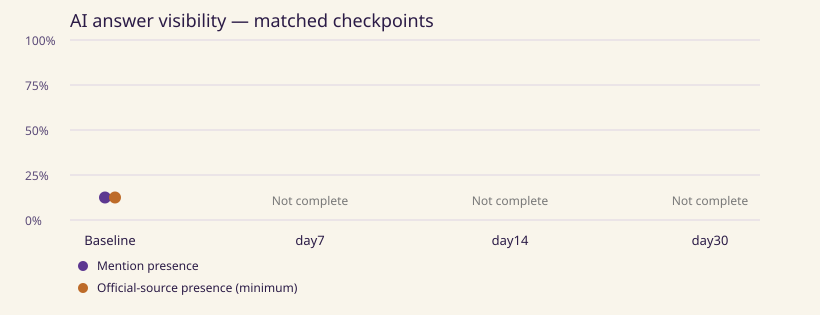

# Sutra pre-launch AI visibility and citation baseline

The first AEO pages launched October 27, 2026 (America/Toronto). The baseline was captured before launch. This report uses one accepted completed response per prompt/cohort and the scores in `../recommendation-tests.csv`.

## Overall snapshot

- **Brand mention presence:** 7/56 eligible discovery answers, **12.5%**.
- **Recommendation presence:** 7/56, **12.5%**.
- **Observed official-source presence:** 7/56, **12.5% as a lower bound**; the recorded sources were not comprehensive.

These are descriptive combined figures across four surfaces, with different account and prompt conditions; they are not an independently sampled, competitive share of voice or a complete citation share. Use the separate cohorts below when interpreting them. Claude T13/T14 have a documented scoring discrepancy, so the aggregate mention and recommendation figures are provisional.

The chart begins with the baseline. Follow-up points are shown only when all 56 eligible baseline-matched responses are present and uniquely scored; partial checkpoints are reported as incomplete, not zero. The [trend detail](aeo-trend.md) shows coverage and denominators.

| Surface / cohort | Eligible answers | Recommended | Mentioned in answer | Answers with an observed official Sutra source |
|---|---:|---:|---:|---:|
| ChatGPT Search / owner-unpersonalized | 14 | 2/14 (14.3%) | 2/14 (14.3%) | 2/14, observed minimum |
| Claude web search / owner-personalized / exact | 4 | 1/4 (25.0%) | 1/4 (25.0%) | 1/4, observed minimum |
| Claude web search / owner-personalized / prefixed | 10 | 1/10 (10.0%) | 1/10 (10.0%) | 0/10, observed minimum |
| Google AI Overview / owner-personalized | 14 | 0/14 (0.0%) | 0/14 (0.0%) | 0/14, observed minimum |
| Perplexity Search / logged-out | 3 | 0/3 (0.0%) | 0/3 (0.0%) | 0/3, observed minimum |
| Perplexity Search / owner-personalized | 11 | 3/11 (27.3%) | 3/11 (27.3%) | 4/11, observed minimum |

## What these figures mean

- **Mentioned** is a visibility score of 2 or 3; **recommended** is score 3. Both denominators are eligible, completed discovery prompts; the four controls are excluded.
- These are Sutra **presence rates**, a narrow visibility proxy. The ledger does not consistently record all competing brands, so a true share of all brand mentions, ranking across brands, or market share cannot be calculated.
- An observed official Sutra source is a recorded URL to `sutra-reader.com` or a subdomain, Sutra's Apple listing (`id6780096864`), or Sutra's Google Play listing (`com.koustavdg.sutra`). A source-panel link is not necessarily an inline citation or a recommendation. Third-party pages discussing Sutra are not counted as official sources.
- Citations are **observed minima**, not comprehensive citation rates: some source panels were incomplete or not fully expanded. Zero means no matching URL was recorded, not proof that none existed.
- These small samples use the owner's account where noted. The primary ChatGPT cohort used the per-chat unpersonalized setting, not an independent evaluator. Don't pool personalized and unpersonalized cohorts, Claude exact and prefixed prompts, or Perplexity logged-out and signed-in cohorts.
- Google T10 uses the fully expanded second capture; Claude T05 uses the accepted first prefixed capture. The owner accepted 58/72 exact prompt/surface pairs and 14 Claude prefix variants, without treating the variants as exact.
- **Reconciliation needed:** `../baseline-status.md` says the Claude T13 and T14 answers mention Sutra, while their ledger scores are 1 (source-only). The private capture summaries corroborate answer-text mentions; T13 also refers to the owner's app, indicating possible personalization contamination. The table follows the ledger; review the underlying evidence and protocol before treating those Claude counts as final.
- Results are descriptive, not evidence of causal impact or a guarantee of future recommendations.

## Evidence and reruns

- Prompt definitions: `../prompts.csv`.
- Scored attempts and source URLs: `../recommendation-tests.csv`.
- Claim accuracy: `../recommendation-claims.csv`.
- Evidence index and private paths: `../evidence-manifest.csv`; raw captures are in the task's `aeo-baseline` evidence directory outside the public site.
- Reproduce this summary with `python3 scripts/aeo_checkpoints.py baseline`. See `aeo-checkpoint-guide.md` for follow-up runs and matched comparisons.

These working files may contain private evidence references or account/session context. Keep raw captures and follow-up logs outside the public repository; the Pages artifact excludes `docs/` and `scripts/`, but the GitHub repository itself is public.
