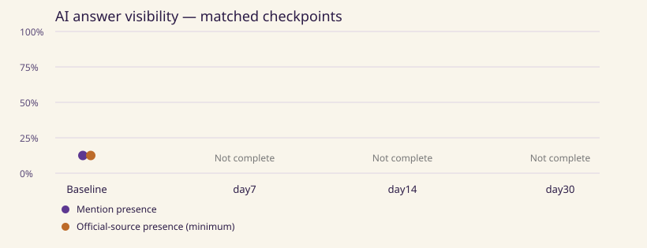

# Sutra AI visibility trend

## Current measured comparison — November 27, 2026

Later [Perplexity compact follow-up](perplexity-compact-2026-11-27.md): T14 and N02 completed after access resumed. Compact current recommendations: **4/5**; matching four-prompt baseline subset: **2/4 → 3/4**. Overall matched discovery coverage is now **36/56**. The full-set snapshot table/chart below has not been regenerated and retains its earlier 35/56 coverage.

Supplemental [user-supplied Claude compact check](claude-user-supplied-2026-11-27.md): one recommendation in five discovery answers, plus one control without a false Sutra recommendation. Claude Pro, Sonnet, all six chats in Incognito, separate new chats and web search enabled are user-confirmed; exact model version remains unknown. Incognito differs from the memory-on baseline, so this starts a separate compact cohort and is not added to the browser-verified matched-cohort totals below.

Fresh tests now provide **35/56 baseline-matched discovery answers**. Read the [current-state report](ai-visibility-current-2026-11-27.md) for prompt-level changes, access gaps and methodology; [download the metrics](ai-visibility-metrics-2026-11-27.csv).

| Surface / matched cohort | Mentions before → now | Recommendations before → now | Observed official sources before → now |
|---|---:|---:|---:|
| Google AI Overview · 14 prompts | 0/14 → 2/14 | 0/14 → 2/14 | 0/14 → 2/14 |
| ChatGPT Unpersonalized · 14 prompts | 2/14 → 2/14 | 2/14 → 1/14 | 2/14 → 2/14 |
| Perplexity signed-in · T04–T10 only | 3/7 → 2/7 | 3/7 → 2/7 | 4/7 → 4/7 |

Claude browser testing requires sign-in; user-supplied Incognito results are recorded separately above. Perplexity remains quota-blocked after the latest user-authorized compact T14 retry. Its T01–T03 current signed-in answers do not match the logged-out baseline. Missing answers are not zero. Citation values are observed minima, not full citation rates. These small samples do not demonstrate causality or an overall gain across all services.

Routine checks now use the user-approved compact set: **T01, T05, T08, T09, T14, plus control N02**. Future compact comparisons must use the same five discovery prompts and account conditions; do not compare their percentages directly with 14-query results. The historical full-cohort coverage below remains separate.

## Full-cohort checkpoint coverage

The chart below deliberately has no new aggregate point until all 56 baseline matches are available. Its day-30 coverage has been refreshed; per-surface results above are already measured and must not be mistaken for missing data.

<!-- generated by sutra aeo_checkpoints.py -->

Overall scores are pooled, descriptive prompt-presence measures across mixed cohorts, not competitive share of voice. Citation values are observed official-source minima, not complete citations. See the per-surface baseline report and its Claude T13/T14 caveat.

| Checkpoint | Matched eligible answers | Mention presence | Recommendation presence | Observed official-source presence |
|---|---:|---:|---:|---:|
| Baseline | 56 | 7/56 (12.5%) | 7/56 (12.5%) | 7/56 (12.5%, observed minimum) |
| day7 | Incomplete | N/A | N/A | N/A |
| day14 | Incomplete | N/A | N/A | N/A |
| day30 | Incomplete | N/A | N/A | N/A |

| Follow-up | Uniquely matched discovery prompts | Unmatched/incomplete records | Duplicate records |
|---|---:|---:|---:|
| day7 | 0/56 | 0 | 0 |
| day14 | 0/56 | 0 | 0 |
| day30 | 35/56 | 5 | 0 |

Follow-up points appear only when all 56 accepted baseline discovery answers have one matching completed, scored response with the same surface, cohort, exact prompt and eligibility. Duplicates are excluded rather than silently selected. Inspect controls and failed/blocked attempts in raw logs. Model, locale, search settings and personalization still require manual review. A complete matching key does not establish causality or full citation capture.
